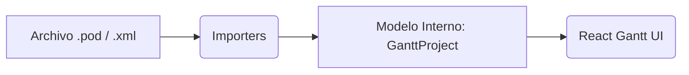

# Arquitectura de Maxima Project

## Principios Generales
El proyecto sigue una estructura centrada en dominios para mantener separado el código de negocio (modelos, conversores) de la presentación (UI/React).

## Estructura de Directorios

```text
src/
├── app/          # Next.js App Router (Páginas y API Routes si hubiesen)
├── components/   # Componentes UI (Botones, Tablas, Timeline, Layout)
│   ├── gantt/    # Componentes específicos de la vista Gantt
│   └── ui/       # Componentes base
├── domain/       # Modelos e interfaces TypeScript (Independientes de React)
├── importers/    # Lógica de importación (POD, XML a Modelos de Dominio)
├── mock/         # Datos estáticos para pruebas
└── utils/        # Funciones utilitarias generales
```

## Flujo de Datos (Arquitectura Objetivo)

El objetivo es que la UI sea completamente independiente del formato de origen del proyecto (ProjectLibre, MS Project, etc.).



## Componentes UI del Gantt

La vista principal del Gantt estará dividida en dos grandes áreas sincronizadas:

1. **GanttTable (Izquierda)**: Muestra la jerarquía de las tareas, nombres, avance y controles de expansión.
2. **GanttTimeline (Derecha)**: Muestra las barras en el tiempo, dependencias e hitos.

Ambas vistas deben compartir el estado de qué tareas están expandidas/colapsadas, y su scroll vertical debe estar en sincronía.
