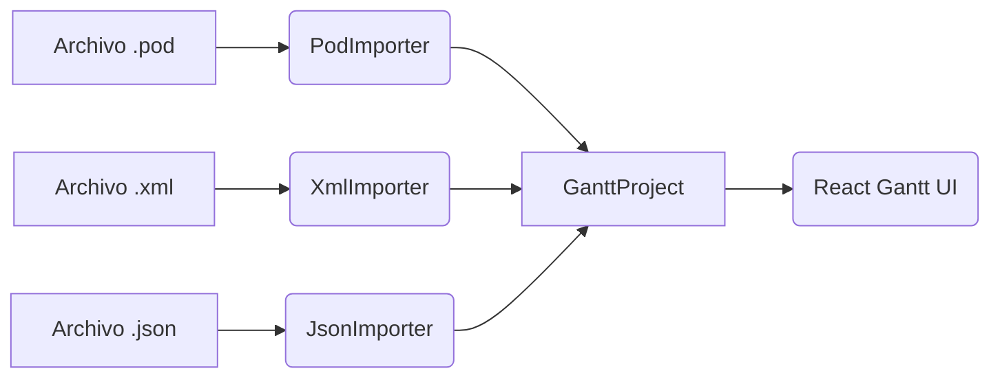

# Arquitectura de Maxima Project

## Principios Generales
El proyecto sigue una estructura centrada en dominios para mantener separado el código de negocio (modelos, conversores) de la presentación (UI/React).

## Estructura de Directorios

```text
src/
├── app/          # Next.js App Router (Páginas y API Routes si hubiesen)
├── components/   # Componentes UI (Botones, Tablas, Timeline, Layout)
│   ├── gantt/    # Componentes específicos de la vista Gantt
│   └── ui/       # Componentes base
├── domain/       # Modelos e interfaces TypeScript (Independientes de React)
├── importers/    # Lógica de importación (POD, XML a Modelos de Dominio)
├── mock/         # Datos estáticos para pruebas
└── utils/        # Funciones utilitarias generales
```

## Flujo de Datos (Arquitectura Objetivo)

El objetivo es que la UI sea completamente independiente del formato de origen del proyecto (ProjectLibre, MS Project, etc.). Actualmente, la importación real de XML está integrada y lista para usarse, mientras que POD y JSON se considerarán en futuras iteraciones.



## Componentes UI del Gantt

La vista principal del Gantt estará dividida en dos grandes áreas sincronizadas:

2. **GanttTimeline (Derecha)**: Visualización temporal interactiva (barras, scroll, grid, hitos).

- `projectXmlImporter`: Conversor de XML (ProjectLibre / MS Project) a `GanttProject`. Implementa lógica de resolución resiliente (`resolveTaskProgress`) para seleccionar el campo más adecuado (e.g. `PhysicalPercentComplete` vs `PercentComplete`) y guarda metadata (`importMetadata`) para trazabilidad. Traduce el formato `Duration` usando `<MinutesPerDay>` del proyecto para evitar asumir horas por defecto, preservando metadatos si fue "estimated".

Ambas vistas deben compartir el estado de qué tareas están expandidas/colapsadas, y su scroll vertical debe estar en sincronía.
